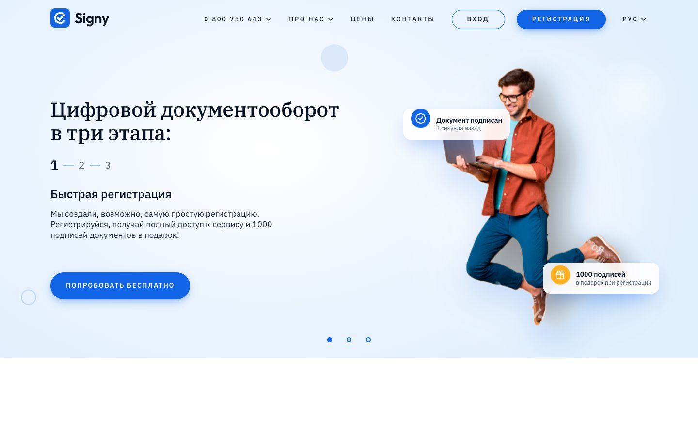
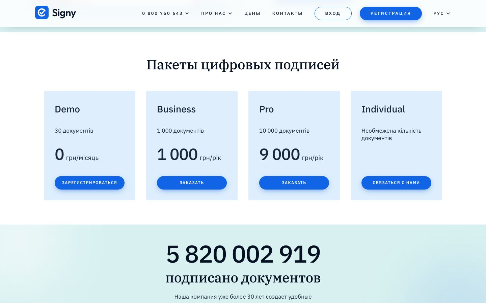
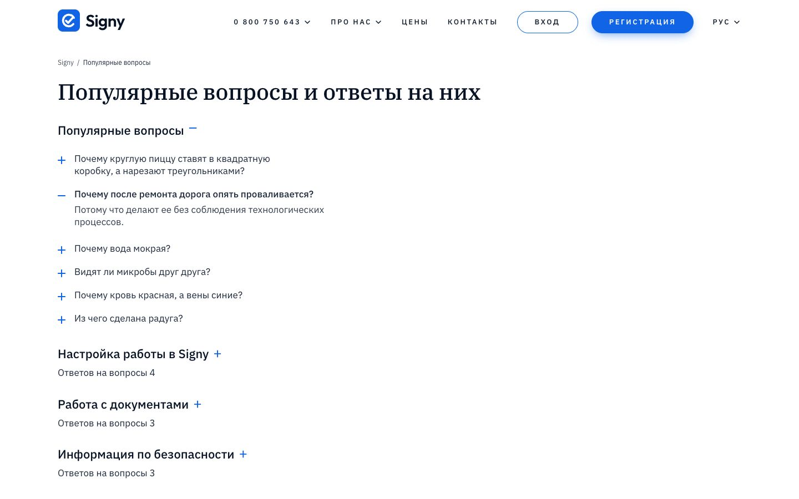
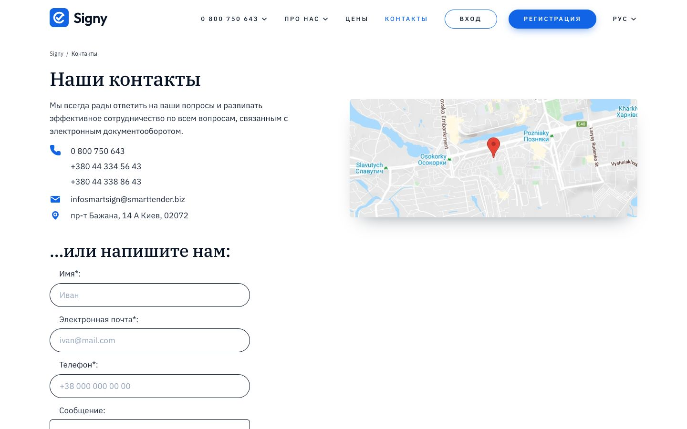
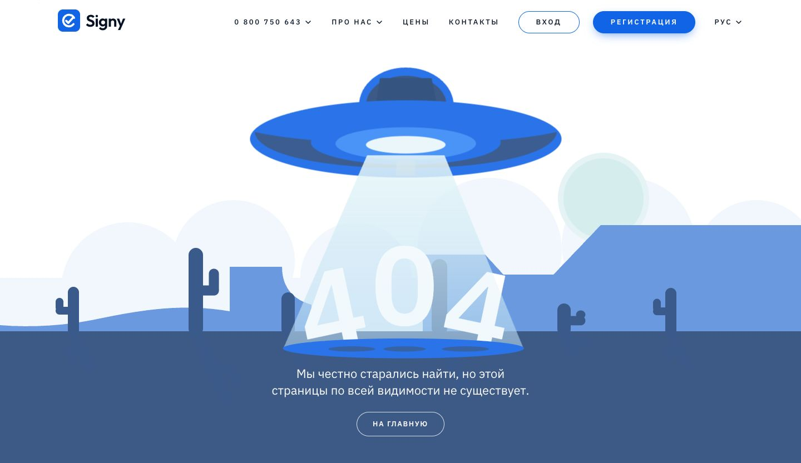
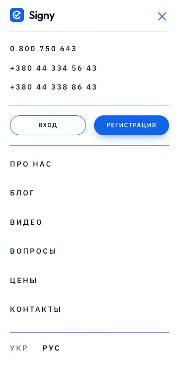
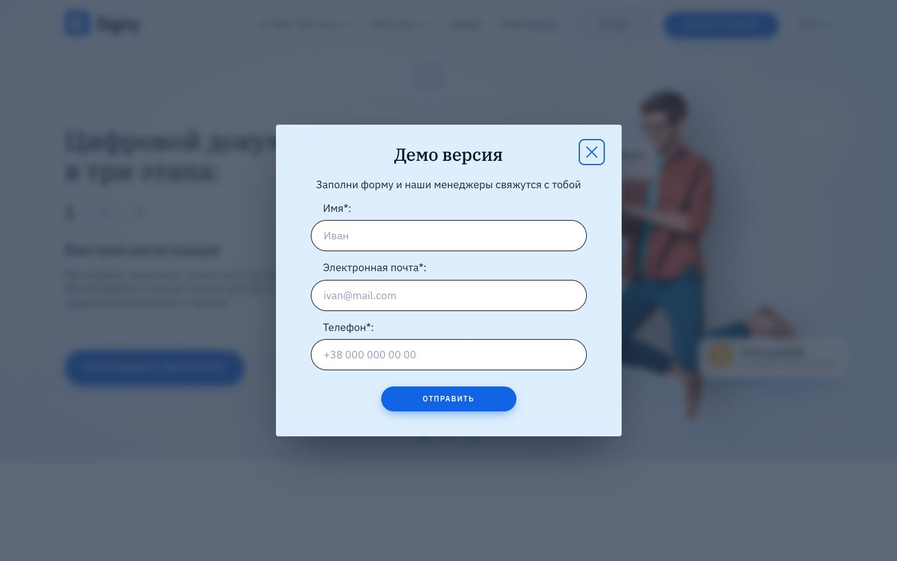

# Signy — сайт сервиса цифрового документооборота

Многостраничный сайт-лендинг сервиса электронных подписей **Signy**: главная с тарифами, блог со статьями, видеоинструкции, FAQ, контакты, «Про нас» и забавная страница 404 с НЛО. Сверстан по макетам из папки `design/` (десктоп 1440 px, планшет и мобильная версия 320 px), но с анимациями и живыми функциями: слайдер, формы с валидацией, фильтры блога, аккордеоны, видеоплеер, модальные окна.

Бэкенда нет — все «запросы» обращаются к моку с задержкой сети (см. [Данные](#данные-и-запросы)). Проект готов к деплою на Vercel.

|  |  |
|---|---|
|  |  |
|  |  |
|  |  |
|  |  |

<p>
  
  
  
</p>

## Что использовалось

| Задача | Библиотека |
|---|---|
| UI, сборка | **React 19**, **TypeScript**, **Vite 8** |
| Роутинг | **react-router** (data router, ленивые страницы) |
| Серверное состояние | **@tanstack/react-query** (`useQuery` для статей, видео, FAQ; `useMutation` для форм) |
| Формы и валидация | **react-hook-form** + **zod** + `@hookform/resolvers` |
| Стили | **Tailwind CSS 4** (токены темы в `@theme`), `clsx` + `tailwind-merge` |
| Анимации | **motion** (появление при скролле, слайдер, аккордеоны, модалки, счётчик) |
| Иконки | **lucide-react** (+ свои SVG: логотип, конверт, НЛО) |
| Шрифты | **IBM Plex Sans / Serif** и **Outfit** (логотип) через `@fontsource` — кириллица включена, шрифты отдаются с вашего домена |

## Запуск

```bash
npm install
npm run dev       # разработка: http://localhost:5173
npm run build     # проверка типов + production-сборка в dist/
npm run preview   # посмотреть собранную версию
npm run lint      # ESLint (включая правила безопасности)
npm test          # тесты безопасности
```

Нужен Node.js 20.19+ (или 22.12+).

## Деплой на Vercel

1. Загрузите проект в репозиторий.
2. На Vercel: **Add New → Project** и выберите репозиторий.
3. Если в репозитории лежат и `design/`, и `signy/`, укажите **Root Directory = `signy`**. Если репозиторий — только содержимое `signy/`, ничего менять не надо.
4. Framework Preset определится сам (Vite): Build `npm run build`, Output `dist`.

Файл [`vercel.json`](vercel.json) перенаправляет все пути на `index.html`, поэтому прямые ссылки (`/blog/…`, `/faq`) и обновление страницы работают.

## Страницы

| Адрес | Страница |
|---|---|
| `/` | Главная: слайдер «три этапа», преимущества, «Комфорт в работе», тарифы (`/#pricing`), счётчик, партнёры, статьи, видео, популярные вопросы, подписка |
| `/about` | Про нас |
| `/blog` | Блог: главная статья, вкладки категорий (фильтр хранится в URL: `?category=news`), сетка, «Показать ещё» |
| `/blog/:slug` | Статья: теги, время чтения, две колонки текста, «Поделиться», предыдущая/следующая |
| `/faq` | Вопросы и ответы по группам + форма «Нет ответа на вопрос?» |
| `/video` | Видеоинструкции: основной плеер, переключение по клику на карточку, «Может быть интересно» |
| `/contacts` | Контакты, карта, форма обратной связи |
| `*` | 404 с анимированной сценой (НЛО, луч, пустыня) |

Модальные окна из макета: **«Демо версия»** (форма заявки → экран «Заявка отправлена») и **«Спасибо»** (после отправки сообщения). Кнопки «Вход», «Регистрация», «Попробовать бесплатно» и кнопки тарифов открывают окно «Демо версия» — отдельных страниц входа в макетах нет.

## Архитектура (Feature-Sliced Design)

Слои подчиняются правилу «импортировать можно только то, что ниже»: `app → pages → widgets → features → entities → shared`. Наружу каждый срез отдаёт только то, что экспортировано в его `index.ts`.

```
src/
├── app/            Провайдеры (react-query, motion, окно «Демо»), роутер, общий layout (RootLayout, скролл), стили
├── pages/          Страницы. Каждая страница устроена одинаково:
│   └── home/
│       ├── ui/            HomePage — только собирает секции
│       ├── sections/      Секции страницы
│       │   └── hero/
│       │       ├── ui/       компоненты (JSX)
│       │       ├── model/    данные, хуки, логика (слайдер, контент)
│       │       └── index.ts
│       └── index.ts
├── widgets/        Крупные блоки, которые повторяются на страницах:
│                   header, footer, subscribe-section, partners-carousel
├── features/       Действия пользователя: demo-request, send-message, subscribe
│                   (schema.ts → zod, api/ → мок-запрос, model/ → useMutation, ui/ → форма)
├── entities/       Бизнес-сущности: post, video, faq, plan, partner
│                   (схема zod, api, react-query-хуки, карточки)
└── shared/         Переиспользуемое без бизнес-логики:
    ├── ui/         Button, TextField, Modal, Reveal, CountUp, Logo …
    ├── lib/        cn, форматирование, валидаторы полей, хуки (фокус в модалке, scroll-lock)
    ├── config/     маршруты, контакты компании
    ├── api/        имитация сети, ApiError
    └── assets/     картинки
```

Принципы: **JSX живёт в `ui/`, а логика, данные и хуки — в `model/`**. Секции страниц не знают друг о друге; то, что нужно нескольким страницам, поднято на уровень выше (`widgets`, `features`, `entities`). Состояние, которое делят секции одной страницы (например, выбранное видео), лежит в `model/` самой страницы.

## Как это работает

### Данные и запросы

Весь «бэкенд» — функции в папках `api/` сущностей и фич: они возвращают данные из мок-базы через `simulateLatency(...)` (`shared/api`). Ответы разбираются **zod-схемами**, поэтому форма данных проверяется так же, как будет проверяться ответ реального сервера. Когда появится настоящий API, меняется только тело этих функций — UI и хуки react-query остаются прежними.

* Чтение: `useQuery` с `queryOptions` (`entities/*/model/queries.ts`), скелетоны на время загрузки, повтор при ошибке.
* Запись: `useMutation` (`features/*/model/*`), кнопка показывает спиннер, ошибка и успех отображаются в форме.

### Формы

Три формы (заявка на демо, сообщение менеджерам, подписка) собраны на `react-hook-form` + `zod`. Телефон вводится через маску `+38 0XX XXX XX XX`: только цифры, лишние не набрать, буквы отбрасываются. Общие правила полей (имя, e-mail, телефон) лежат в `shared/lib/validation.ts` и используются везде одинаково. Ошибки показываются под полем с `role="alert"`, поля связаны с подсказками через `aria-*`.

### Анимации

* `Reveal` — мягкое появление блоков при скролле; `CountUp` — счётчик подписанных документов; слайдер героя с автопереключением (пауза при наведении), аккордеоны FAQ, переходы модальных окон, анимированный конверт и сцена 404.
* Системная настройка «уменьшить движение» учитывается: `MotionConfig reducedMotion="user"` и `prefers-reduced-motion` в CSS.

### Навигация и доступность

* Скролл к якорю `/#pricing` работает и при переходе с другой страницы; при обычном переходе страница прокручивается наверх.
* Мобильное меню и модальные окна: ловушка фокуса, закрытие по `Esc`, возврат фокуса, блокировка прокрутки страницы. Есть ссылка «К содержимому» для клавиатуры.
* Контент статей хранится как структурированные блоки (абзац / заголовок / картинка) и выводится обычными React-элементами — без `dangerouslySetInnerHTML`.

## Что заглушка и что заменить

* **Картинки** вырезаны из макетов (`src/shared/assets/images`) в разрешении макета; кнопки Play на видео-превью закрашены и заменены настоящей кнопкой. Для финала лучше подставить оригиналы из дизайна.
* **Тексты** страницы «Про нас», а также статьи блога и ответы FAQ — демонстрационные.
* **Видео**: все ролики сейчас ведут на один YouTube-ролик (`1VEogQzZ93U`) — ID задаются в `entities/video/api/video.api.ts`. Плеер YouTube подгружается только по клику на Play (домен `youtube-nocookie.com`).
* **Карта** на странице контактов — картинка со ссылкой на Google Maps.
* **Язык**: переключатель «РУС / УКР» — только интерфейс, украинской версии нет.
* **Партнёры**: в макете 4 логотипа, три страницы карусели показывают их в другом порядке.
* **Добавлено сверх макета**: плавающие карточки в первом экране, ссылка «Все вопросы» в блоке FAQ на главной, кнопка «Показать ещё» в блоге, время чтения статьи.
* «Договір оферти» и «Безпека сервісу» в подвале — просто текст: страниц в макетах нет.

## Безопасность

Подробно — в [docs/SECURITY.md](docs/SECURITY.md). Коротко:

* **Заголовки и строгий CSP** в `vercel.json` (скрипты и ресурсы только со своего домена + YouTube для видео, без `unsafe-eval`, запрет встраивания сайта в чужие страницы, HSTS, Permissions-Policy и т.д.). Те же заголовки отдаёт `npm run preview` — можно проверить локально.
* **Формы**: zod-валидация и очистка текста, лимиты длины, honeypot, минимальное время заполнения, ограничение числа отправок.
* **XSS**: контент выводится только React-элементами; ESLint запрещает `dangerouslySetInnerHTML`, `innerHTML`, `eval` и т.п.; данные и параметры адреса проверяются (slug, адреса картинок).
* **Зависимости**: `npm run audit:prod`, Dependabot раз в неделю.
* Что нельзя закрыть без бэкенда (капча, серверная валидация и лимиты, сессии) — в разделе 5 документа.

```bash
npm test          # 22+ тестов: валидация, очистка, лимиты, URL, заголовки CSP
npm run audit:prod
```
